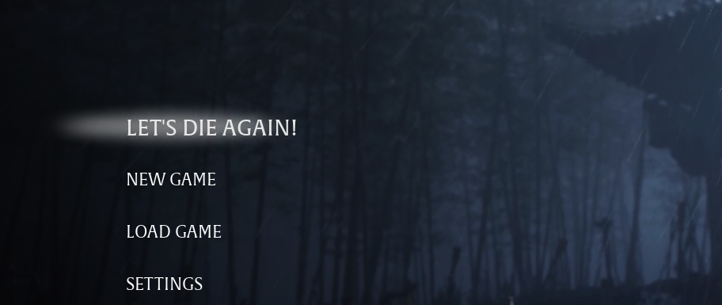

# Let's Die Again!

The main menu's CONTINUE entry reads LET'S DIE AGAIN! instead (English text).

## What it does

- The main menu's CONTINUE entry says LET'S DIE AGAIN! instead.
- It still does what CONTINUE does: it loads your last save.
- Only the English text changes. Nothing else in the game changes.

## Screenshots

## How to install

1. Download the zip of the latest release on GitHub (`phantombladezero_letsdieagain_<version>.zip`).
2. Open the game folder `ProjectPBZ\Content\Paks\`. If it has no folder `~mods`, create it.
3. Unpack the three files of the zip (`phantombladezero_letsdieagain_P.pak`, `.utoc` and `.ucas`) into `ProjectPBZ\Content\Paks\~mods\`.
4. Start the game.

To update the mod, replace the three files with the ones of the new release. To remove it, delete the three files.

## How to use

Nothing to do: play the game in English and look at the main menu.

## Compatibility

- Game version: Release (Steam build 26266538) (`CL-301524_JKS-17219`).
- No UE4SS needed.
- The mod replaces the game's English text file, `ProjectPBZ/Content/Localization/Game/en-US/Game.locres` (every
  English text of the game, with one of them changed). A mod that replaces the same file, for example another text
  mod or a fix of the English texts, conflicts with this one; only one of them works.

## Known issues

- Only English: in the other 15 languages the entry keeps the game's own text.
- After a game update that changes any English text, this mod brings the old texts back until a new version of the
  mod is out. Remove the mod if texts look wrong after an update.

## How to build

Anyone can build this mod from its source code and check that the download matches it.

1. Install the tools: Windows PowerShell 5.1 (part of Windows), [repak](https://github.com/trumank/repak/releases)
   v0.2.3 and [retoc](https://github.com/trumank/retoc/releases) v0.1.5 in a folder `_tools\repak\` and `_tools\retoc\`
   above the repository (or set `UE5_TOOLS`); optional: [Node.js](https://nodejs.org/) for the check of JavaScript.
   `README.md` has the details.
2. Build it: `powershell -ExecutionPolicy Bypass -File .\build.ps1`
3. Find the files: `dist\phantombladezero_letsdieagain_P.pak`, `.utoc` and `.ucas`.

## Credits

Made by Kintaro. MIT license: you may use, change and share this mod. Phantom Blade Zero and its files belong to
their makers; the mod changes only what is listed above.
